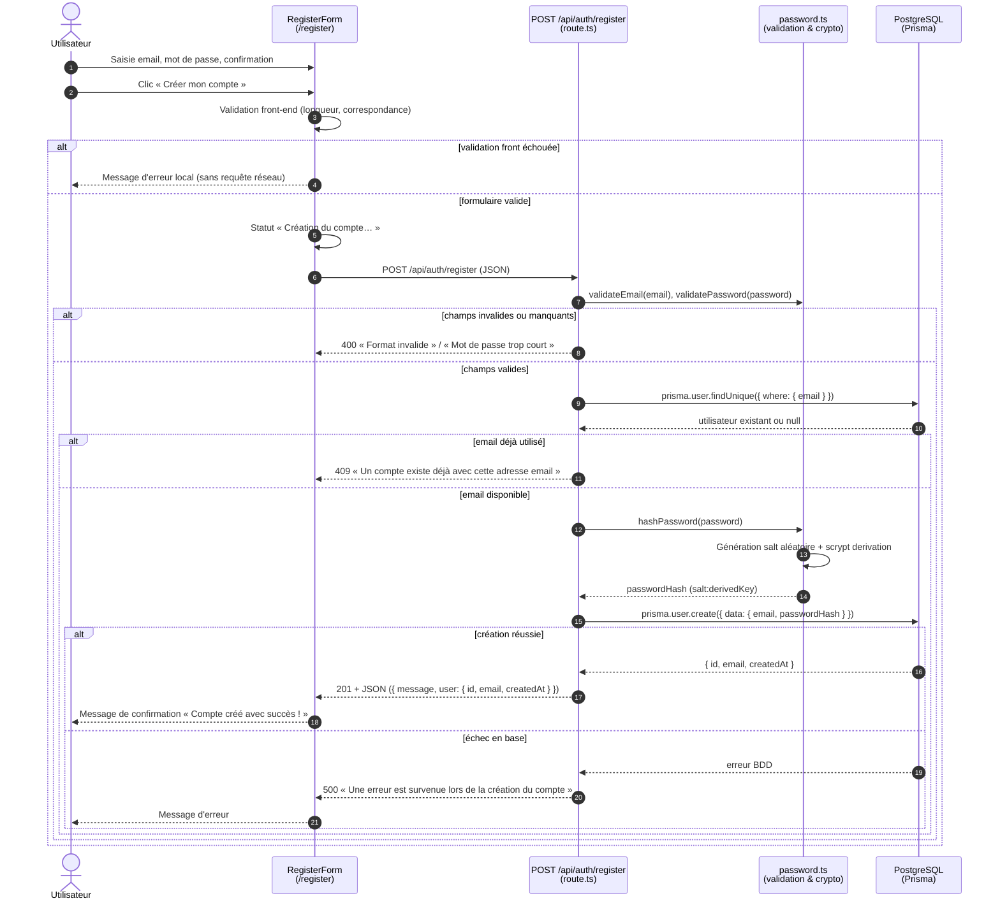

# Diagramme de séquence — US-A1 : créer un compte

> En tant qu'utilisateur, je peux créer un compte pour accéder au service.

L'utilisateur fournit son adresse email et son mot de passe. Après validation du format, unicité de l'email et hachage cryptographique du mot de passe (via `scrypt`), l'utilisateur est persisté dans la base PostgreSQL via Prisma, sans jamais exposer le mot de passe en clair.

## Lecture du diagramme

- **Validations à deux niveaux** :
  - **Côté client (`RegisterForm`)** : vérification immédiate que les mots de passe correspondent et font au moins 8 caractères avant d'envoyer la requête réseau.
  - **Côté serveur (`route.ts` & `password.ts`)** : validation stricte du format email (RFC) et des longueurs pour se prémunir des requêtes directes via API/curl.
- **Sécurité et hachage** :
  - Le mot de passe en clair n'est jamais stocké.
  - La fonction de hachage utilise `crypto.scrypt` (module natif `node:crypto`) avec un sel aléatoire de 16 octets, conforme aux recommandations OWASP.
  - Le hash renvoyé en base n'est jamais retourné dans le corps de réponse JSON (`select: { id: true, email: true, createdAt: true }`).
- **Gestion des doublons (statut 409 Conflict)** :
  - Si l'email est déjà enregistré, une réponse `409` claire est retournée sans compromettre l'intégrité de la table `User` (contrainte unique).

Code concerné : [`src/app/register/page.tsx`](../../src/app/register/page.tsx), [`src/app/register/register-form.tsx`](../../src/app/register/register-form.tsx), [`src/app/api/auth/register/route.ts`](../../src/app/api/auth/register/route.ts), [`src/lib/password.ts`](../../src/lib/password.ts), [`prisma/schema.prisma`](../../prisma/schema.prisma).
