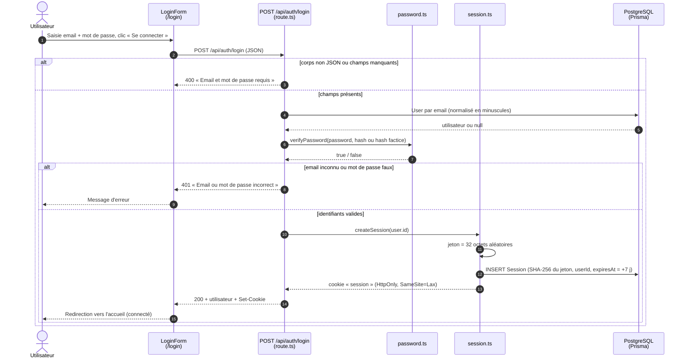
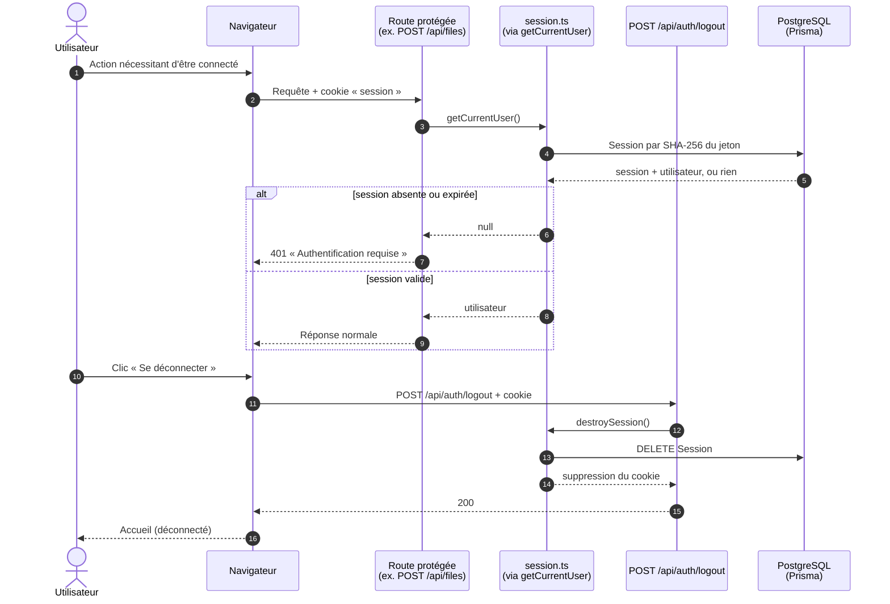

# Diagramme de séquence — US-A2 : se connecter / se déconnecter

> En tant qu'utilisateur, je peux me connecter et me déconnecter.

À la connexion, le serveur vérifie le mot de passe (`scrypt`, cf. US-A1), crée une session en base et pose un cookie `session` (`HttpOnly`). Le cookie contient un jeton aléatoire ; la base n'en conserve que l'empreinte SHA-256. Les routes protégées (ex. upload, US-B1) retrouvent l'utilisateur à partir de ce cookie via `getCurrentUser()`.

## Connexion

## Requête authentifiée et déconnexion

## Lecture des diagrammes

- **Message d'erreur unique (401)** : la réponse est identique que l'email soit inconnu ou le mot de passe faux, et un hachage factice est vérifié quand l'email est inconnu, pour ne pas révéler quels comptes existent (ni par le message, ni par le temps de réponse).
- **Jeton haché en base** : une fuite de la table `Session` ne permet pas d'usurper une session, puisque le jeton en clair n'existe que dans le cookie.
- **Cookie `HttpOnly`** : inaccessible au JavaScript de la page, ce qui limite le vol de session par XSS ; `SameSite=Lax` limite les requêtes inter-sites (CSRF) ; `Secure` est activé en production.
- **Déconnexion côté serveur** : la session est supprimée en base, donc un cookie copié avant la déconnexion ne fonctionne plus.
- **Sessions expirées** : refusées à la lecture (`expiresAt`) ; elles ne sont pas encore purgées de la base (amélioration possible).

Code concerné : [`src/app/login/`](../../src/app/login/), [`src/app/logout-button.tsx`](../../src/app/logout-button.tsx), [`src/app/api/auth/login/route.ts`](../../src/app/api/auth/login/route.ts), [`src/app/api/auth/logout/route.ts`](../../src/app/api/auth/logout/route.ts), [`src/lib/session.ts`](../../src/lib/session.ts), [`src/lib/current-user.ts`](../../src/lib/current-user.ts).
