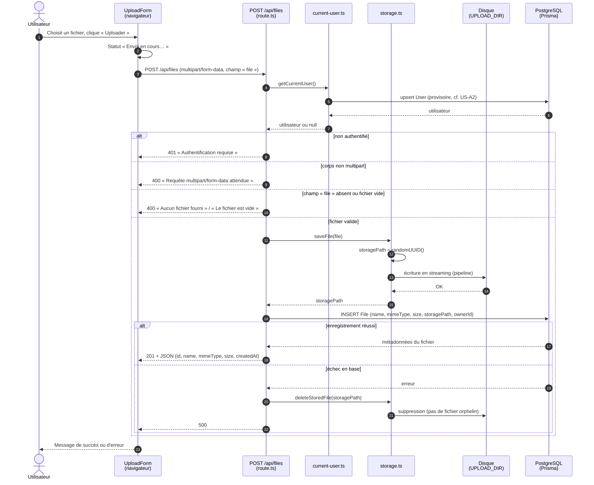

# Diagramme de séquence — US-B1 : uploader un fichier

> En tant qu'utilisateur, je peux uploader un fichier.

Le contenu du fichier est écrit sur disque (`UPLOAD_DIR`) sous un nom aléatoire ; ses métadonnées (nom d'origine, type, taille, propriétaire) sont enregistrées en base dans la table `File`, reliées au contenu par `storagePath`.

## Lecture du diagramme

- **Étapes 4 à 7 — identification** : temporairement, `getCurrentUser()` renvoie toujours l'utilisateur de démo `demo@partage.local`. Une fois US-A2 livrée, il lira la session et pourra renvoyer `null` (→ 401).
- **Validations (bloc `alt`)** : elles ont lieu *avant* toute écriture, pour ne jamais toucher au disque avec une requête invalide. La validation de taille max et de type est prévue dans US-E2.
- **Écriture sur disque** : le nom aléatoire (`randomUUID`) empêche les collisions entre fichiers de même nom et les attaques par *path traversal* (`../`). Le nom d'origine n'est conservé qu'en base.
- **Cohérence disque / base** : si l'insertion en base échoue après l'écriture sur disque, le fichier est supprimé pour ne pas laisser d'orphelin.

Code concerné : [`src/app/upload-form.tsx`](../../src/app/upload-form.tsx), [`src/app/api/files/route.ts`](../../src/app/api/files/route.ts), [`src/lib/current-user.ts`](../../src/lib/current-user.ts), [`src/lib/storage.ts`](../../src/lib/storage.ts).
