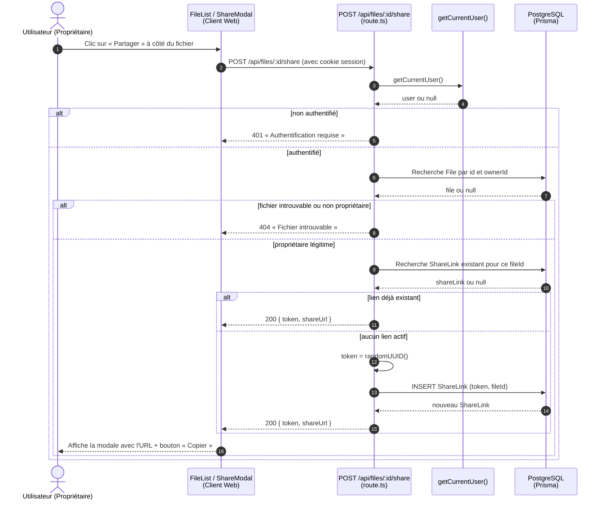
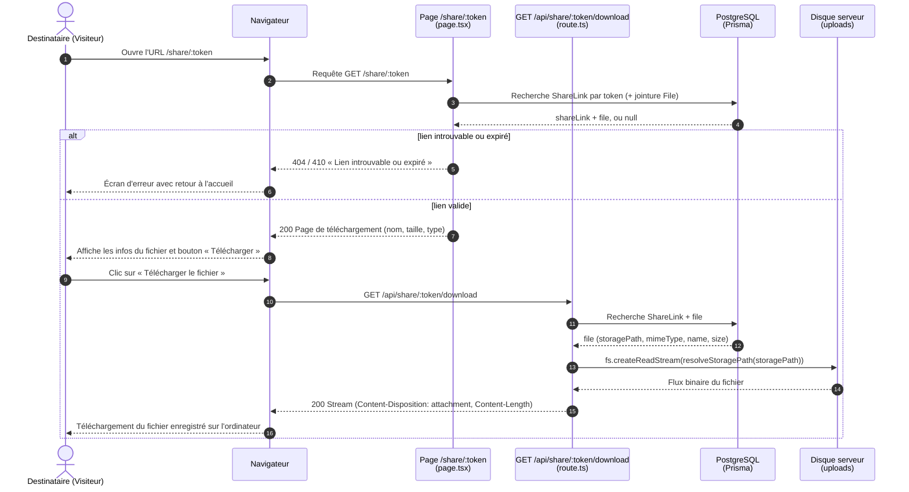

# Diagramme de séquence — US-C1 & US-C3 : générer un lien de partage et accéder au fichier partagé

> **US-C1** : En tant qu'utilisateur, je peux générer un lien de partage pour un fichier.  
> **US-C3** : En tant que destinataire, je peux accéder à un fichier partagé via le lien ou via mon compte.

---

## 1. Génération et révocation d'un lien de partage (US-C1)

Seul le propriétaire du fichier peut générer un lien de partage. Le serveur associe un jeton UUID v4 unique au fichier en base de données et renvoie l'URL correspondante (`/share/<token>`).

---

## 2. Consultation et téléchargement par un tiers (US-C3)

Le destinataire accède au lien public sans avoir besoin d'être authentifié. Le téléchargement réutilise le modèle de flux Node.js (`fs.createReadStream` vers `ReadableStream`) avec les en-têtes HTTP de streaming.

---

## Principes de sécurité et d'architecture

- **Jeton UUID cryptographique** : Les liens de partage utilisent des UUID v4 aléatoires. Ils ne peuvent être ni devinés par énumération, ni prédits.
- **Contrôle d'accès strict à la création** : Seul le propriétaire authentifié (`ownerId === user.id`) peut créer ou révoquer un lien de partage.
- **Accès public découplé** : La route `/share/:token` et le téléchargement `/api/share/:token/download` ne nécessitent aucune session, permettant le partage sans friction.
- **Sécurité du stockage** : La fonction `resolveStoragePath` garantit l'imperméabilité du répertoire de stockage face aux attaques par traversée de répertoire (*Path Traversal*).
- **Préparation pour les extensions** : Les champs `expiresAt` et `password` sont prévus dans le schéma pour les évolutions du Sprint 3 (US-D1, US-D2).

Code concerné :
- Modèle : [`prisma/schema.prisma`](../../prisma/schema.prisma)
- API propriétaire : [`src/app/api/files/[id]/share/route.ts`](../../src/app/api/files/[id]/share/route.ts)
- API publique & streaming : [`src/app/api/share/[token]/download/route.ts`](../../src/app/api/share/[token]/download/route.ts)
- Frontend : [`src/app/file-list.tsx`](../../src/app/file-list.tsx), [`src/app/share-modal.tsx`](../../src/app/share-modal.tsx), [`src/app/share/[token]/page.tsx`](../../src/app/share/[token]/page.tsx)

