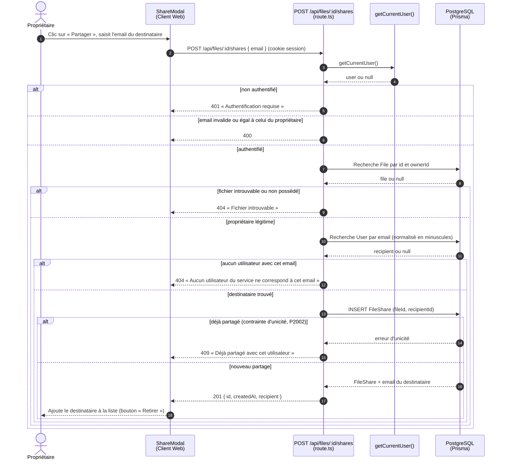
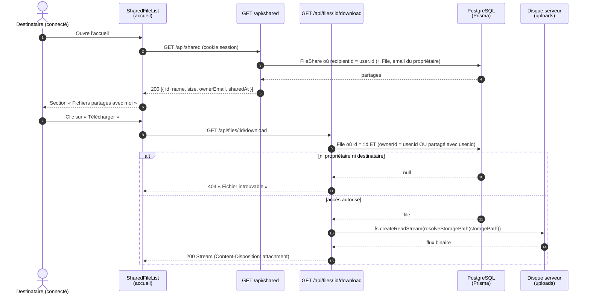

# Diagramme de séquence — US-C2 : partager un fichier avec un autre utilisateur du service

> **US-C2** : En tant qu'utilisateur, je peux partager un fichier directement avec un autre utilisateur du service.

Le propriétaire désigne le destinataire par son email. Le partage est enregistré dans la table `FileShare` (couple `fileId` / `recipientId` unique) : aucun lien public n'est créé. Le destinataire retrouve le fichier dans la section « Fichiers partagés avec moi » de l'accueil (US-C3, accès via le compte).

---

## 1. Partage par le propriétaire

Le retrait d'un destinataire suit le même schéma avec `DELETE /api/files/:id/shares/:recipientId` : la suppression est filtrée sur `file.ownerId = user.id`, donc seul le propriétaire peut retirer un partage (`404` sinon).

---

## 2. Accès par le destinataire

---

## Principes de sécurité

- **Partage ciblé** : contrairement au lien public (US-C1), seul le destinataire connecté peut télécharger le fichier ; une copie de l'URL de téléchargement ne suffit pas.
- **Contrôle d'accès en une requête** : le téléchargement vérifie en base que l'utilisateur est propriétaire ou destinataire ; un tiers obtient `404`, sans distinguer « fichier inexistant » et « accès refusé ».
- **Révocation immédiate** : retirer un destinataire supprime la ligne `FileShare`, ce qui coupe l'accès dès la requête suivante.
- **Suppressions en cascade** : supprimer le fichier ou le compte du destinataire supprime les partages associés (`onDelete: Cascade`).
- **Énumération des comptes** : la réponse `404` sur un email inconnu révèle si un compte existe. C'est accepté pour un service interne à l'université, où le propriétaire doit savoir si son destinataire est inscrit.

Code concerné :
- Modèle : [`prisma/schema.prisma`](../../prisma/schema.prisma) (modèle `FileShare`), migration `20261106162413_add_file_share`
- API propriétaire : [`src/app/api/files/[id]/shares/route.ts`](../../src/app/api/files/[id]/shares/route.ts), [`src/app/api/files/[id]/shares/[recipientId]/route.ts`](../../src/app/api/files/[id]/shares/[recipientId]/route.ts)
- API destinataire : [`src/app/api/shared/route.ts`](../../src/app/api/shared/route.ts), [`src/app/api/files/[id]/download/route.ts`](../../src/app/api/files/[id]/download/route.ts)
- Frontend : [`src/app/share-modal.tsx`](../../src/app/share-modal.tsx), [`src/app/file-list.tsx`](../../src/app/file-list.tsx), [`src/app/shared-file-list.tsx`](../../src/app/shared-file-list.tsx)
