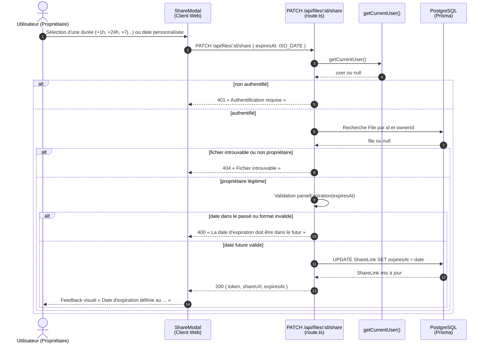
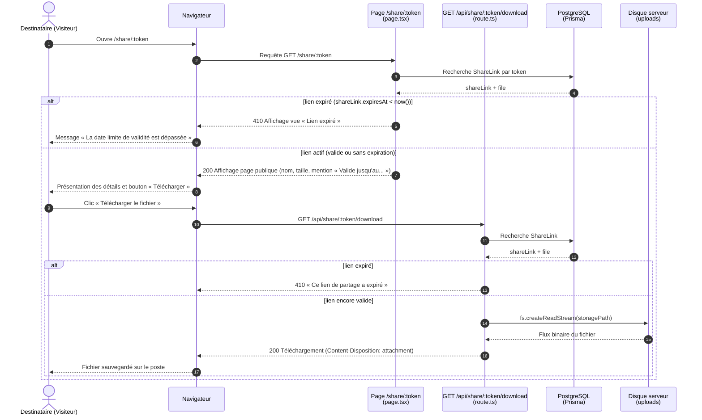

# Diagramme de séquence — US-D1 : expiration d'un lien de partage

> **US-D1** : En tant qu'utilisateur, je peux définir une date d'expiration sur un lien de partage.

---

## 1. Définition ou mise à jour de la date d'expiration (Propriétaire)

Le propriétaire d'un fichier peut configurer ou modifier la date d'expiration d'un lien à tout moment via la modale de partage (durées pré-définies ou date personnalisée).

---

## 2. Consultation et téléchargement avec vérification temporelle (Destinataire)

Lorsqu'un visiteur accède à un lien de partage, le serveur vérifie si une date d'expiration est définie et si elle est dépassée. Le rejet intervient avant toute autre vérification (notamment avant le mot de passe).

---

## Principes de conception et sécurité

- **Validation temporelle stricte** : Le serveur refuse toute date d'expiration antérieure ou égale au moment présent (`Date.now()`).
- **Priorité de sécurité** : La vérification d'expiration est effectuée en première ligne, avant le contrôle du mot de passe (US-D2). Un lien expiré ne permet aucun téléchargement ni tentative d'authentification.
- **Réactivation sans rupture** : Un lien expiré conserve son token UUID ; le propriétaire peut simplement mettre à jour la date d'expiration dans la modale pour le réactiver instantanément sans générer une nouvelle URL.
- **Transparence pour le destinataire** : Si une date de fin de validité est configurée, elle est clairement signalée sur la page de téléchargement afin que l'utilisateur sache jusqu'à quand le document reste accessible.

Code concerné :
- API de modification : [`src/app/api/files/[id]/share/route.ts`](../../src/app/api/files/[id]/share/route.ts)
- API de consultation & téléchargement : [`src/app/api/share/[token]/route.ts`](../../src/app/api/share/[token]/route.ts), [`src/app/api/share/[token]/download/route.ts`](../../src/app/api/share/[token]/download/route.ts)
- Frontend : [`src/app/share-modal.tsx`](../../src/app/share-modal.tsx), [`src/app/file-list.tsx`](../../src/app/file-list.tsx), [`src/app/share/[token]/page.tsx`](../../src/app/share/[token]/page.tsx)
